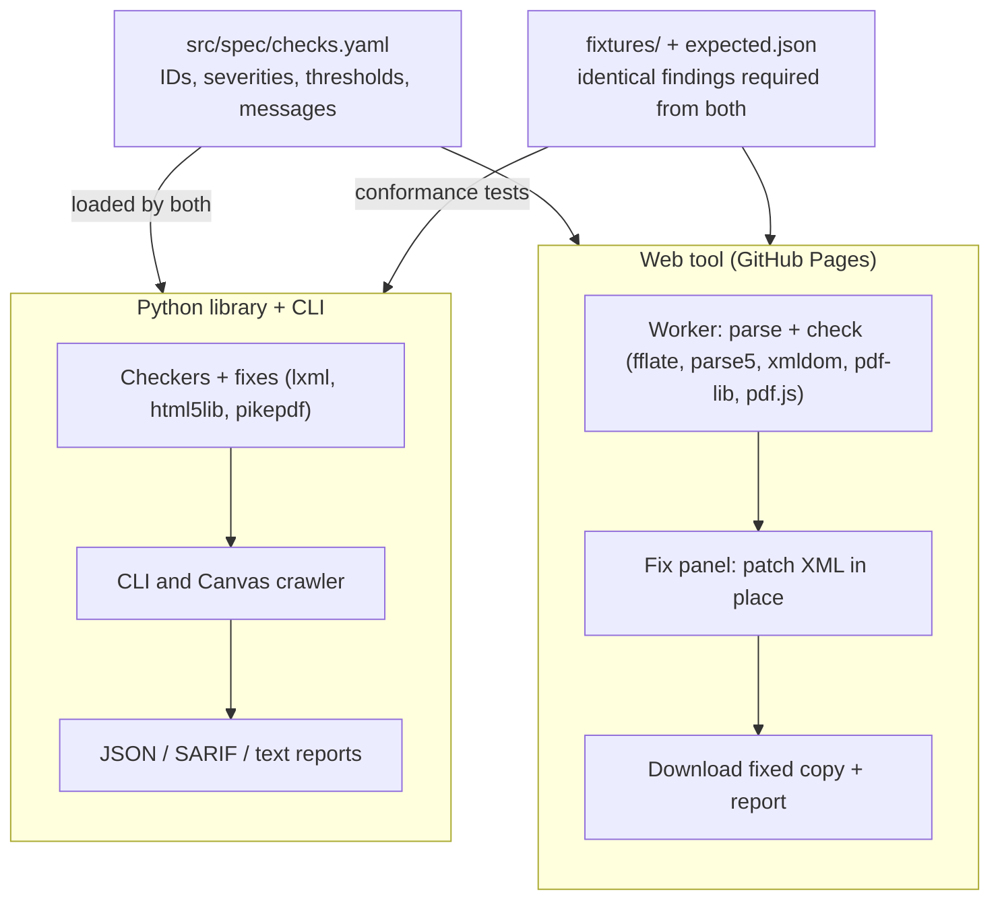

# Overview

One shared check specification drives two engines: a single-file Python library and CLI for batch and Canvas-wide scans, and a static GitHub Pages app that checks a single document, guides fixes, and returns a corrected copy. Working name: `panocheck`. Keep "YuJa" and "Panorama" out of the name and branding.

**Goals**

- Reproduce Panorama's published checks for HTML, PDF, DOCX, PPTX and XLSX, with ODF and legacy formats through conversion in Python.
- Emit stable, machine-readable findings (JSON, SARIF) with a locator precise enough to jump to the problem.
- Web tool: drop a file, see issues by severity, fix them in the browser, download the fixed file. No upload: every byte stays client-side, which keeps student data and FERPA concerns out of scope.
- Same findings from both engines on the same input, enforced by a shared fixture suite.

**Non-goals (v1)**

- Matching Panorama's numeric score exactly; its weights are unpublished. Scores are an estimate, reported separately from findings.
- Tagging untagged PDFs, OCR of scanned PDFs, or reading-order repair. These are detected, not fixed.
- Caption checks and legacy DOC/PPT/XLS/RTF in the web tool. Python handles them.

## Architecture

A monorepo with one declarative check spec; neither engine hard-codes thresholds, severities or messages. The web build loads the YAML. `src/tools/sync_spec.py` embeds it in `panocheck.py`.



```
src/
  md/                # this directory
  spec/              # checks.yaml, schema.json
  python/            # panocheck.py (single file), tests
  web/               # Vite app -> GitHub Pages
  tools/             # fixture generator, spec sync, LibreOffice smoke test
fixtures/            # generated test documents + expected.json
.github/workflows/   # test, pages deploy
```

See [data/FINDING.md](data/FINDING.md) for the finding schema.

## Risks

| Risk | Impact | Mitigation |
| --- | --- | --- |
| Panorama's exact rules and weights are unpublished | Findings and score diverge from what instructors see | Calibration set; label the score "estimate"; document known differences |
| Panorama changes its checks | Silent drift | Re-run calibration each term; spec versioned with a changelog |
| Fixes corrupt files | Users lose work | Byte-preserving patches; round-trip tests; always keep the original download untouched |
| pdf-lib rewrite drops forms, signatures or incremental history | Damaged PDFs | Detect these features and warn, or refuse PDF fixes on such files |
| Contrast false positives (gradients, text over images) | Noise, lost trust | Report as "needs review" below a confidence threshold |
| "Meaningful alt text" is subjective | Disagreement with Panorama | Heuristics only in v1: generic-word list, filename pattern, length |
| Large PDFs in the browser | Slow or crashed tab | Worker, page-by-page streaming, size warning above a cap |
